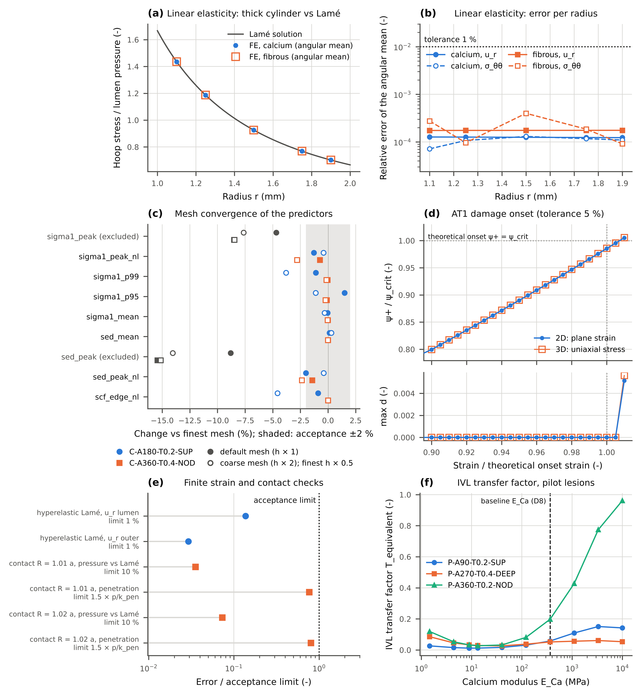
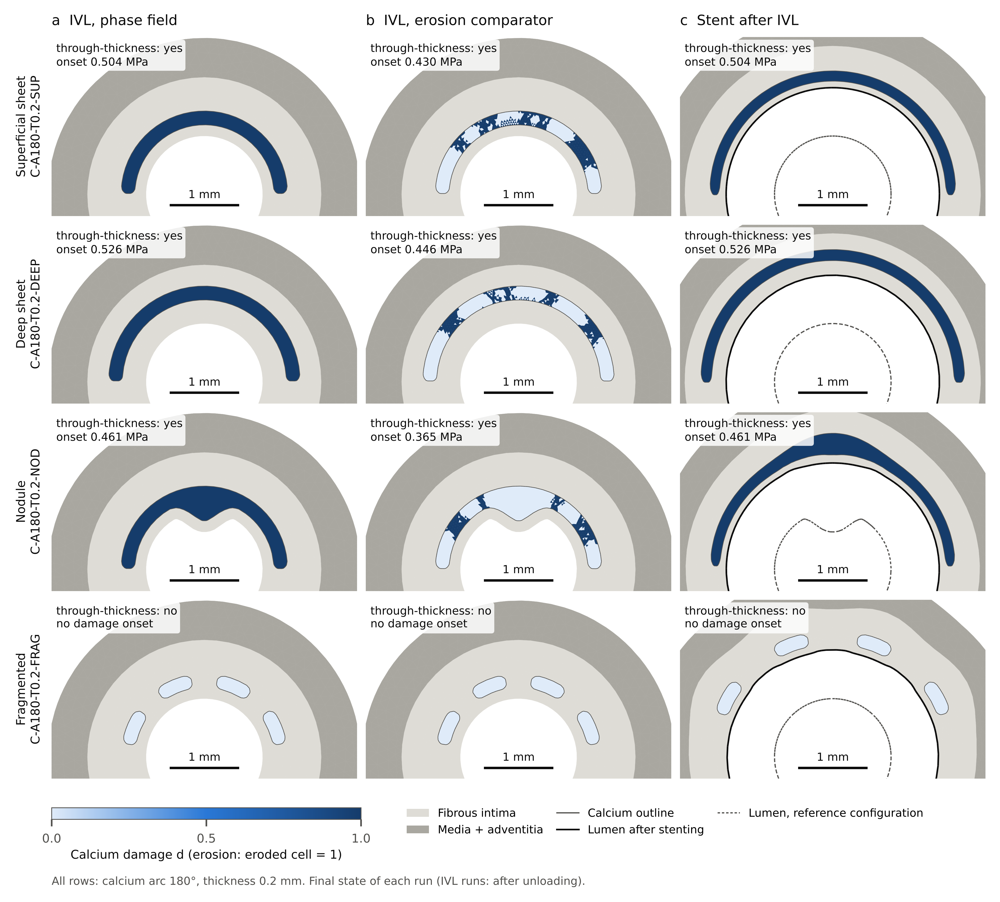
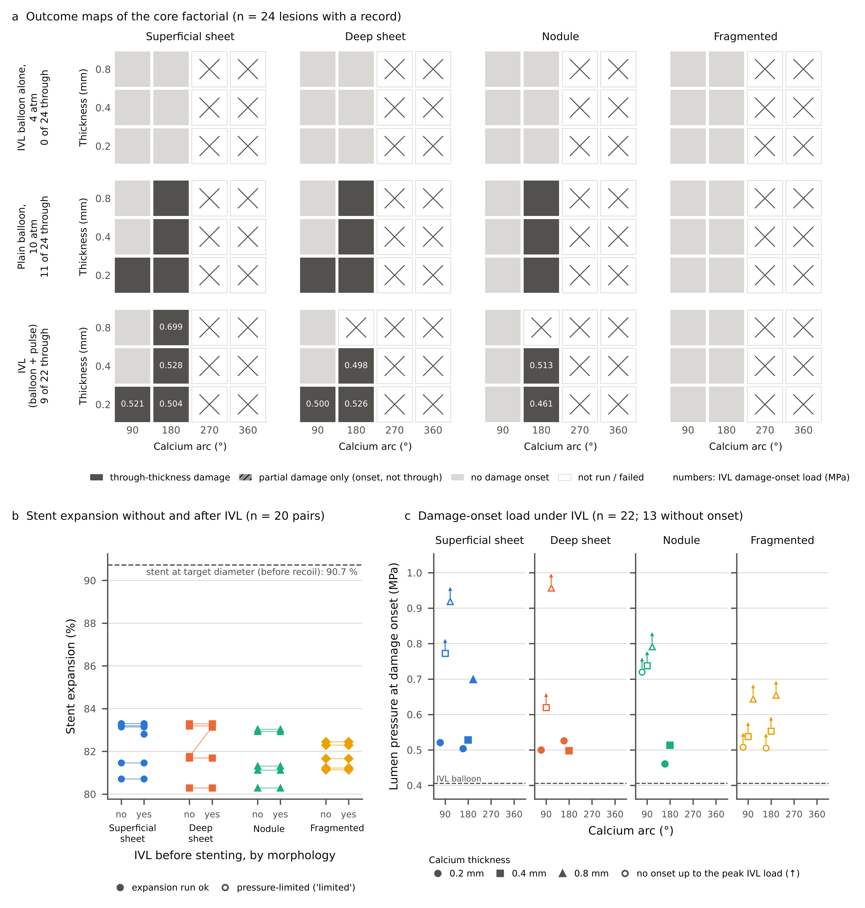
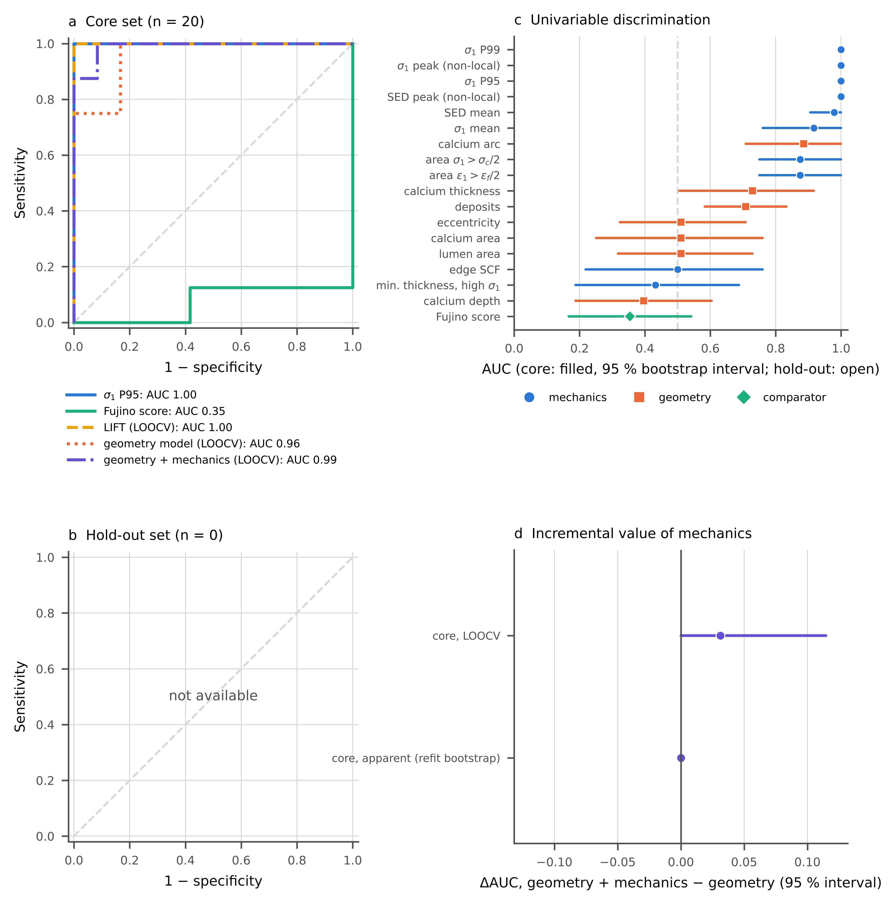

# In Silico Digital Twins of Calcified Coronary Lesions under Intravascular Lithotripsy and Stenting

[Author names and affiliations to be added.]

**Background/Objectives:** Intravascular lithotripsy (IVL) fractures coronary calcium before stenting, but which lesions fracture is hard to predict from imaging scores. We asked whether mechanics computed before treatment predict calcium fracture under IVL in *in silico* lesions. **Methods:** Calcified coronary cross-sections were generated as a designed core set (34 lesions: calcium arc, thickness and morphology) and a sampled hold-out set (0 lesions). Candidate predictors came from a linear-elastic analysis of the untreated lesion. The outcome, through-thickness calcium damage, came from a separate nonlinear finite element model with a phase-field fracture law under an equivalent IVL load. Thresholds and a composite index were derived on the core set and tested unchanged on the hold-out set, against the optical coherence tomography (OCT) calcium score of Fujino. **Results:** On the core set, the non-local peak $\sigma_1$ had an area under the receiver operating characteristic curve (AUC) of 0.96 (95% CI 0.89–1.00), and the Fujino score 0.62 (95% CI 0.43–0.78). The composite index LIFT had a leave-one-out AUC of 0.95 (95% CI 0.85–1.00). A geometry-only model reached 0.88, and adding mechanics gave 0.92 (not clearly different). On the hold-out set, the non-local peak $\sigma_1$ had an AUC of [pending] (95% CI [pending]–[pending]). The model reproduced the published association of fracture with calcium arc but not the clinical fracture rates. **Conclusions:** In this model, pre-treatment mechanics ranked lesions for calcium fracture under IVL better than the Fujino score, with no clear gain in discrimination over geometry alone. These are *in silico* results; they require comparison with OCT after IVL in patient lesions.

**Keywords:** intravascular lithotripsy; coronary artery calcification; finite element analysis; phase-field fracture; digital twin; in silico; stent expansion; optical coherence tomography

## 1. Introduction

Severe coronary calcification resists balloon dilation and limits stent expansion, and stent underexpansion is the main mechanical consequence that lesion preparation tries to prevent [1,2]. Plain and cutting balloons and intravascular lithotripsy (IVL) all aim to fracture the calcium so that the vessel wall can expand [3–5]. Whether a given lesion will fracture is therefore a practical question before treatment.

Coronary IVL delivers acoustic pressure pulses from electrohydraulic emitters inside a semi-compliant balloon, which is inflated at only 4 atm (0.405 MPa) to appose the wall [6,7]. The peak positive pressure is about 5 MPa (the measurement location relative to the balloon is not stated), and the proposed fracture mechanism is the compressive stress of the wavefront [5]. Intravascular optical coherence tomography (OCT) substudies found calcium fracture in 78.7% of lesions in Disrupt CAD II [8] and in 67.4% in Disrupt CAD III, with multiple fractures in 67.7% of the fractured lesions; stent expansion was 101.7 ± 28.9% at the site of maximum calcification and 78.4 ± 25.8% at the site of minimum stent area (mean ± standard deviation) [9]. A pooled OCT analysis of the Disrupt CAD studies reported 3.1 ± 2.7 fractures per lesion, 72% of them through the full calcium thickness [10]. Fracture depends on morphology: it occurred at only 23.1% of calcified-nodule sites in the pooled Disrupt CAD III and IV OCT substudies [11], and in an OCT study after IVL it was associated with a larger calcium arc, a smaller minimum calcium thickness and superficial calcium, with lower odds for nodular calcium (odds ratio 0.24) [12]. Clinical OCT fracture rates may underestimate fracture: in an *ex vivo* study of laser (not electrohydraulic) lithotripsy, histology showed microfractures that OCT did not show [13].

Before treatment, the expected result is estimated from imaging. The Fujino OCT calcium score awards 2 points for a maximum calcium angle above 180°, 1 point for a maximum calcium thickness above 0.5 mm and 1 point for a calcium length above 5 mm; lesions with the maximum score of 4 had a stent expansion of 78% against 96% for lower scores [2]; the score was derived to predict underexpansion, not fracture. A revised OCT calcium score includes a minimum calcium thickness above 0.30 mm among its criteria [14], and machine learning on OCT lesion attributes predicts underexpansion [15]. Fracture cut-offs were derived for plain balloons (calcium angle 225°) [3] and cutting balloons (calcium angle 198° and calcium thickness 0.445 mm) [4], and an IVL study identified morphological associations with fracture [12]. All of these predictors are geometric. They contain neither the load nor the stiffness of the calcium and the surrounding tissue, nor the stress concentration at the ends of a deposit.

Finite element (FE) models have been used to study balloon angioplasty and stenting [16,17] and the effect of calcification on plaque stress [18]. In calcified lesions, the predicted stresses and damage depend strongly on the constitutive representation [19], heavily calcified lesions carry a larger share of the balloon load [20], and simulation-driven machine learning has predicted stent expansion [21]. Calcium fracture under plain and cutting balloons has been assessed through the maximum principal stress [22] or a brittle calcium model [23]. *In silico* studies of lesion preparation [24] and the *ex vivo* laser-lithotripsy study [13] prescribed the fracture and simulated its effect, so fracture was an input rather than a prediction. Variational phase-field models of brittle fracture can predict whether and where a crack forms without a prescribed path: they regularise the crack over a length $\ell$ [25], have robust staggered solvers [26], link crack nucleation to the material strength [27] and have been applied to arterial tissue [28]. Pipelines from intravascular images to FE models [29–31] bring lesion-specific digital twins, in the sense proposed for precision cardiology [32], within reach, and the in silico trial framework sets out how the credibility of such models is established [33].

To our knowledge, no study has tested whether lesion-level mechanics from a computationally cheap pre-treatment analysis predict IVL-induced fracture better than geometry or the Fujino score, in a controlled cohort in which the fracture comes from a separate simulation. Clinical data cannot answer this directly: morphology and device use vary together, OCT under-detects fractures, and each lesion is treated once. The inputs are also uncertain: calcium moduli range from about 1.5 MPa in tissue-level tension [34] to the gigapascal range at the particle scale, reported from nanoindentation and summarised in a parametric FE study [35], and the only tissue-level fracture data for calcified plaque that we found come from one uniaxial tension study of human iliac plaques [36].

This study addresses that question with a structured in silico cohort. A full factorial core set of 48 two-dimensional (2D) cross-sections combines 4 calcium arcs, 3 thicknesses and 4 morphologies (superficial sheet, deep sheet, calcified nodule, fragmented), a design choice based on the superficial and deep distribution of calcium [1] and the OCT classes of calcified plaque [37]; a hold-out set of 24 lesions is drawn by Latin hypercube sampling over continuous ranges of calcium arc, thickness and depth, lumen area and plaque eccentricity, with the four morphologies in equal numbers and a lipid pool under a fibrous cap assigned to half of the samples. Lesions are polar label maps in the OCT segmentation convention of [31,38], so that segmented images, together with an outer-wall contour, could enter the same pipeline (tested here only on synthetic masks). Predictors come from the geometry and from a linear-elastic analysis of the undamaged lesion under the IVL balloon pressure. Outcomes come from a separate nonlinear simulation with phase-field damage in the calcium, in which IVL is the quasi-static equivalent of a single acoustic pulse, followed by stent expansion. This equivalence represents the peak tensile response of the calcium to one pulse; it does not resolve the compressive wavefront or repeated pulses. The primary outcome is through-thickness calcium damage under IVL; crack number and pattern are not analysed. Predictors are evaluated by receiver operating characteristic (ROC) analysis with leave-one-out cross-validation (LOOCV) and bootstrap intervals, combined by penalised logistic regression on at most 3 mechanics predictors into the Lithotripsy-Induced Fracture Tendency (LIFT) index, and compared with the Fujino score computed from its angle and thickness criteria (at most 3 points, since the length criterion is not defined in a cross-section). Geometry-only and geometry-plus-mechanics models give the incremental value of mechanics. Thresholds and models are derived on the core set and applied unchanged to the hold-out set. The baseline calcium modulus is calibrated to a criterion internal to the model (the IVL balloon alone does not fracture the calcium, IVL does), and the published modulus range is covered by the sensitivity analysis. No patient data are used: the study offers verification against analytical solutions and under mesh refinement, consistency with published observations and sensitivity analysis of uncertain inputs, not a clinical test of the predictors.

## 2. Materials and Methods

### 2.1. Study Design

This is an *in silico* study; no patient data were used. A structured cohort of calcified coronary cross-sections was generated and stored as polar label maps, and every lesion was analysed by two separate finite element models (Figure 1). The predictor model is a cheap pre-treatment analysis: the lesion geometry and one linear-elastic solve of the undamaged lesion under the IVL balloon pressure. The outcome model is a separate nonlinear simulation of the treatment with phase-field damage in the calcium. All predictors were computed from the predictor model and the geometry only, and all outcomes from the outcome model only. The two models share the lesion geometry and the material constants, including the calcium modulus; no quantity computed by the outcome model is used as a predictor. In particular, the IVL load factor of the transient pulse analysis (Section 2.5) is an input of the outcome model and is excluded from the candidate predictors by a check in the code.

Every input of the two-dimensional (2D) main analysis is listed with its value, source and status in Table 1, except the sampling ranges of the hold-out set, which are given in Section 2.2. Inputs with status UNVERIFIED were not used. Most literature values were checked against text attributed to their source in search results rather than against the full primary article. Secondary-source inputs (the tissue densities of the transient model and the physiological pressure, decision D15) and one provisional input (the lipid modulus) were used and are flagged in Table 1. Decisions taken during the study are numbered D1–D15 and recorded in the configuration file.

**Table 1.** Model inputs. Literature values with their status (VERIFIED: value confirmed in the cited source; SECONDARY: from a secondary source; DERIVED: computed from other inputs; DESIGN or ASSUMPTION: study choice), the range used in the sensitivity analysis, and the source or basis.

| Group | Parameter | Symbol | Value | Unit | Sensitivity range | Status | Source |
|---|---|---|---|---|---|---|---|
| geometry | lumen area (circular lumen, core set) | $A_L$ | 2.2 | mm² |  | VERIFIED | [9] |
| geometry | reference vessel diameter (stent-expansion reference) | $D_{ref}$ | 3.37 | mm |  | VERIFIED | [39] |
| geometry | plaque thickness, lumen to IEL | $t_p$ | 0.848 | mm |  | DERIVED | [9,39] |
| geometry | wall thickness, media + adventitia | $t_w$ | 0.567 | mm |  | DERIVED | [40,41] |
| geometry | calcium depth: superficial sheet, nodule, fragmented | $z_s$ | 0.16 | mm |  | VERIFIED | [42] |
| geometry | calcium depth: deep sheet | $z_d$ | 0.34 | mm |  | VERIFIED | [42] |
| geometry | minimum fibrous tissue between calcium and IEL | $c_{IEL}$ | 0.05 | mm |  | ASSUMPTION | minimum fibrous tissue between the calcium and the IEL (same 0.05 mm as the hold-out depth rule) |
| geometry | nodule protrusion height | $h_{nod}$ | 0.3 | mm | 0.2; 0.4 | ASSUMPTION | no verified OCT protrusion height found |
| geometry | nodule base arc | β_nod | 60 | deg |  | ASSUMPTION | nodule protrusion spans 60 deg at the centre of the calcium arc |
| geometry | fragment pitch (one deposit per pitch) | Δφ_frag | 45 | deg |  | ASSUMPTION | one deposit per 45 deg of arc (n = arc/45, min 2) |
| geometry | fraction of the pitch filled by a fragment | $f_{frag}$ | 0.6 | - |  | ASSUMPTION | each deposit fills 60% of its pitch |
| geometry | calcium-free end segment (3D models) | $L_m$ | 2 | mm |  | ASSUMPTION | calcium-free segment length at each end of 3D models |
| calcium | Young's modulus (baseline, D8) | $E_{Ca}$ | 365 | MPa | 1.466; 10000 | CALIBRATED | D8, Checkpoint 2: point 6 of the 9 log-spaced pilot sweep points over sens_E (equality checked by … |
| calcium | Poisson's ratio | ν_Ca | 0.3 | - |  | VERIFIED | [35] |
| calcium | density (transient model) | ρ_Ca | 2050 | kg/m³ | 1450 | SECONDARY | [59,60] |
| calcium | longitudinal sound speed (transient model) | $c_{Ca}$ | 2000 | m/s |  | VERIFIED | [56] |
| fibrous tissue | Young's modulus, small strain (neo-Hookean, μ = E/3) | $E_f$ | 2.31 | MPa | 0.927; 4.492 | VERIFIED | [34] |
| fibrous tissue | bulk-to-shear modulus ratio (wall, fibrous tissue, lipid) | K/μ | 50 | - | 20; 200 | ASSUMPTION | near-incompressibility penalty K/mu for soft tissues |
| fibrous tissue | density (transient model) | ρ_f | 1080 | kg/m³ |  | SECONDARY | [61] |
| fibrous tissue | longitudinal sound speed (transient model) | $c_f$ | 1580 | m/s |  | VERIFIED | [57] |
| lipid | Young's modulus, small strain (neo-Hookean, μ = E/3) | $E_{lip}$ | 0.0055 | MPa |  | PROVISIONAL | [49] |
| lipid | density (transient model) | ρ_lip | 920 | kg/m³ |  | SECONDARY | [61] |
| lipid | longitudinal sound speed (transient model) | $c_{lip}$ | 1530 | m/s |  | VERIFIED | [58] |
| lipid | lipid pool thickness (hold-out lesions) | $t_{lip}$ | 0.2 | mm |  | ASSUMPTION | no verified lipid-core thickness found |
| wall | Yeoh coefficient c10 | $c10$ | 0.017 | MPa |  | VERIFIED | [47] |
| wall | Yeoh coefficient c20 | $c20$ | −0.0734 | MPa |  | VERIFIED | [47] |
| wall | Yeoh coefficient c30 | $c30$ | 0.415 | MPa |  | VERIFIED | [47] |
| wall | density (transient model) | ρ_w | 1080 | kg/m³ |  | SECONDARY | [61] |
| wall | longitudinal sound speed (transient model) | $c_w$ | 1610 | m/s |  | VERIFIED | [55] |
| loads | physiological lumen pressure | $p_{phys}$ | 0.016 | MPa |  | SECONDARY | [51] |
| loads | IVL balloon pressure (balloon alone, IVL inflation, predictor load) | $p_{bal}$ | 0.405 | MPa |  | VERIFIED | [6,7] |
| loads | plain balloon pressure (no pulses) | $p_{POBA}$ | 1.01 | MPa |  | VERIFIED | [50] |
| loads | IVL balloon diameter (radial envelope cap) | $D_{IVL}$ | 3.19 | mm |  | VERIFIED | [39] |
| loads | IVL peak positive pulse pressure | $p_{peak}$ | 5 | MPa |  | VERIFIED | [5,7] |
| loads | pulse attenuation factor, emitter to tissue | $s_{pulse}$ | 1 | - | 0.5; 1 | ASSUMPTION | unknown attenuation between emitter and tissue |
| loads | perivascular support stiffness | $k_f$ | 0.0001 | MPa/mm | 0.001; 0.01; 0.1 | ASSUMPTION | negligible support |
| loads | IVL pulse width (half sine, transient model) | $t_{pulse}$ | 2 | us |  | SECONDARY | [54] |
| stent | stent target diameter (expanding rigid cylinder) | $D_{stent}$ | 3.21 | mm |  | VERIFIED | [39] |
| stent | maximum mean balloon pressure (rated burst pressure) | $p_{rated}$ | 1.62 | MPa |  | VERIFIED | [52] |
| stent | acute recoil target of the stiffness identification | $r_{rec}$ | 4.3 | % |  | VERIFIED | [53] |
| stent | malapposition distance threshold | $g_{mal}$ | 0.1 | mm | 0.05; 0.2 | ASSUMPTION | OCT malapposition distance threshold (not verified) |
| stent | stent radial stiffness (identified) | $K_s$ | 6.07 | MPa/mm |  | CALIBRATED | [53] |
| fracture/phase field | calcium failure strain (strain-controlled, primary, D5) | ε_f | 0.02 | - |  | DERIVED | [36] |
| fracture/phase field | calcium failure stress (stress-controlled scenario, D5) | σ_c | 0.179 | MPa |  | VERIFIED | [36] |
| fracture/phase field | regularisation length / calcium element size | ℓ/h | 2 | - | 1.5; 3 | ASSUMPTION | regularisation length = 2 calcium element sizes |
| fracture/phase field | crack filler of fully damaged calcium (D9) | – | matrix |  | none | ASSUMPTION | a fully damaged calcium band keeps the small-strain shear modulus of the fibrous matrix around it … |
| fracture/phase field | damage driving force (D10) | – | energy |  | rankine | ASSUMPTION | force that drives damage in the AT1 damage sub-problem only (the displacement problem always uses g(d) psi+ + … |
| fracture/phase field | residual stiffness of fully damaged calcium | $k_{res}$ | 0.0001 | - |  | NUMERICAL | residual stiffness of fully damaged calcium |
| fracture/phase field | cell-average damage of a cracked cell (post-processing) | $d_{crack}$ | 0.9 | - |  | DESIGN | cell-average d above which a cell is cracked (post-processing) |
| fracture/phase field | crack-filler stiffness floor, max(k_res, μ_f/μ_Ca) | $k$ | 0.00549 | - |  | DERIVED | derived from fracture.crack_filler; fracture.k_residual; materials.fibrous.E; materials.calcium.E; materials.calcium.nu |
| fracture/phase field | regularisation length, (ℓ/h) h_Ca | ℓ | 0.08 | mm |  | DERIVED | derived from fracture.ell_over_h; discretisation.h_calcium_mm |
| fracture/phase field | damage-onset energy density, E_Ca ε_f²/2 | ψ_crit | 0.073 | MPa |  | DERIVED | derived from materials.calcium.E; fracture.eps_f |
| fracture/phase field | implied calcium failure stress, E_Ca ε_f | σ_crit | 7.3 | MPa |  | DERIVED | derived from materials.calcium.E; fracture.eps_f |
| fracture/phase field | fracture toughness, 16 ℓ (1 − k) ψ_crit / 3 (AT1 onset at ψ_crit) | $G_c$ | 0.031 | N/mm |  | DERIVED | derived from fracture.ell_over_h; discretisation.h_calcium_mm; fracture.crack_filler |
| numerics | A-lines of the polar label map | n_θ | 360 | - |  | DESIGN | A-lines (1 deg), IVOCT-like polar map |
| numerics | radial sampling of the polar label map | Δr | 0.01 | mm |  | DESIGN | 10 um radial sampling |
| numerics | element size in and near calcium | $h_{Ca}$ | 0.04 | mm |  | DESIGN | coarse-mesh defaults (user request); mesh convergence study (results/verification_mesh_convergence.json) |
| numerics | element size elsewhere | $h_{soft}$ | 0.15 | mm |  | DESIGN | mesh convergence study (results/verification_mesh_convergence.json) |
| numerics | contact penalty stiffness | $k_{pen}$ | 1000 | MPa/mm |  | NUMERICAL | penalty stiffness |

### 2.2. Lesion Cohort

The core set is a full factorial of calcium arc (90, 180, 270 and 360°), calcium thickness (0.2, 0.4 and 0.8 mm) and morphology (superficial sheet, deep sheet, calcified nodule and fragmented calcium), a design choice based on the superficial and deep distribution of calcium [1] and the OCT classes of calcified plaque [37], giving 48 lesions (Figure 2). All core lesions share one reference geometry: a circular lumen of area 2.2 mm² [9] and an internal elastic lamina at the reference lumen radius (reference vessel diameter 3.37 mm [39]; no remodelling assumed), which gives a plaque 0.848 mm thick, surrounded by a wall (media and adventitia, lumped) of 0.567 mm [40,41]. With the external elastic membrane one media thickness (0.214 mm) outside the internal elastic lamina, the plaque burden is 80.6%. Superficial sheets, nodules and fragments start at a depth of 0.16 mm below the lumen and deep sheets at 0.34 mm, the mean minus and plus one standard deviation of an *ex vivo* OCT series [42]. A nodule adds a protrusion of height 0.3 mm over a base arc of 60° into the lumen; fragmented calcium is split into one deposit per 45° of arc, each filling 60% of its pitch (assumptions). Where the calcium, its depth and a minimum fibrous layer of 0.05 mm above the internal elastic lamina did not fit within the reference plaque, the plaque was grown outward with the lumen unchanged (16 core lesions, all at the thickest level; decision D11); at that level the fragment fill was raised and the base arc of the narrowest nodule reduced so that the deposits fit. The three pilot lesions of the earlier study phase (3; Section 2.4) have the geometry of core lesions C-A90-T0.2-SUP, C-A270-T0.4-DEEP and C-A360-T0.2-NOD.

The hold-out set of 24 lesions was drawn by Latin hypercube sampling (seed 20261010) over continuous ranges of calcium arc (60–360°), thickness (0.2–0.8 mm), depth (0.16–0.34 mm) [42], lumen area (1.4–3 mm²) [9] and plaque eccentricity index (0 to 0.667, the intravascular ultrasound limit of a maximum-to-minimum plaque thickness ratio of 3 [43]). The morphologies followed a balanced cycle. A lipid pool under a fibrous cap was assigned to 50% of the samples and kept where it fitted beside the calcium (8 lesions), with a lipid arc of 90–180° (upper bound: the high-risk lipid arc [44]; lower bound an assumption), a cap thickness of 0.047–0.1 mm (median minimum cap thickness of culprit plaques [45]) and a pool thickness of 0.2 mm (assumption). Where the calcium did not fit, its depth was reduced, and 7 hold-out plaques were grown outward. Thresholds and models derived on the core set were applied to the hold-out set without change.

Each lesion was stored as a polar label map in the OCT convention of [31,38] (A-lines × radial samples; 360 A-lines, 10 µm radial sampling), and the geometric descriptors were computed from the label map only, as they would be from a segmented image: total calcium arc (A-lines containing calcium), maximum calcium thickness (including a nodule protrusion), minimum calcium depth, calcium area, number of deposits, lumen area, lipid arc and plaque eccentricity. The cross-sectional Fujino score awards 2 points for a total calcium arc above 180° and 1 point for a maximum calcium thickness above 0.5 mm [2]; in 2D the length criterion cannot be scored, so the score is at most 3.

### 2.3. Geometry and Meshing

The label map was converted into a conforming partition of lumen, calcium, lipid, fibrous intima (inside the internal elastic lamina) and wall, and meshed with linear triangles in Gmsh [46]. The element size was 40 µm in and next to the calcium and grew to 0.15 mm in the soft tissue. Displacements were interpolated with quadratic (P2) and the damage field with linear (P1) Lagrange elements, under plane strain. For the three-dimensional (3D) length series (Section 2.9), the cross-section was extruded into linear tetrahedra over the calcified length, with calcium-free end segments of 2 mm and the axial displacement fixed on the end faces, using in-plane sizes of 0.15 mm (calcium) and 0.4 mm (soft tissue) and axial sizes of 0.5 mm (calcified segment) and 1 mm (end segments); the phase-field length of these models was 0.3 mm.

### 2.4. Constitutive Models

The wall (media and adventitia, lumped) was an isotropic Yeoh solid with the constants of a Yeoh fit [47] to circumferential data of human coronary media [48], used for the whole lumped wall (assumption). The fibrous intima and the lipid pool were nearly incompressible neo-Hookean solids with small-strain Young moduli of 2.31 MPa (hypocellular human aortic plaque) [34] and 5.5 kPa (atomic force microscopy; provisional, species not confirmed) [49]; the soft tissues used a bulk-to-shear modulus ratio of 50 (an assumption, varied in the sensitivity analysis). Calcium was a compressible neo-Hookean solid defined by its small-strain modulus and a Poisson ratio of 0.3 [35], brittle through the damage model of Section 2.6; up to the failure strain its response is close to linear. In the predictor model all materials were linear elastic with the small-strain constants above.

The calcium modulus is the most uncertain input: published values range from 1.5 MPa for tissue-level tension [34] to the gigapascal range at the particle scale, reported from nanoindentation and summarised in a parametric FE study [35]. In the pilot phase, 9 log-spaced moduli between 1.47 MPa and 10 GPa were run on the three pilot lesions (whose geometries are core lesions, Section 2.2). The baseline was set to 365 MPa (decision D8), the stiffest swept modulus at which the IVL balloon inflated alone did not damage the pilot lesions while IVL did. This is a calibration to a criterion internal to the model, not to a measured property, and the outcome model's response on three core geometries thereby set the modulus that both models use. With the failure strain below, it implies a calcium failure stress of 7.3 MPa, about 41 times the tissue-level strength of 0.18 MPa measured in tension [36], and at this modulus a plain balloon at 10 atm still fractured part of the pilot lesions, unlike in cadaver lesions [50]. The modulus was therefore varied in the sensitivity analysis (Section 2.9).

### 2.5. Boundary Conditions and Load Protocols

The lumen pressure acted as a follower load on the luminal surface. Rigid-body motion was removed by a weak elastic foundation on the outer boundary (0.0001 MPa/mm; its effect on the peak calcium stress is reported in Table 2). Balloons were represented by the lumen pressure inside a rigid cylindrical cap at the balloon radius and the stent by an expanding rigid cylinder, both with frictionless penalty contact (penalty 1000 MPa/mm). 6 protocols were run on every lesion: (i) physiological pressure (16 kPa) [51]; (ii) the IVL balloon alone, a lumen pressure of 4 atm (0.405 MPa) [6] inside a cap at the radius of the IVL balloon (diameter 3.19 mm) [39]; (iii) a plain balloon at 10 atm (1.01 MPa) with the same cap, the balloon arm of a cadaver comparison [50]; (iv) IVL (below); and stent deployment (v) without and (vi) after IVL: the rigid cylinder expanded from just inside the smallest lumen radius to the target stent diameter (3.21 mm) [39], stopping early if the mean contact pressure reached the rated burst pressure of the stent delivery balloon (16 atm (1.62 MPa)) [52]; the stent then recoiled to the radius at which the tissue pressure balanced a linear stent stiffness. The stiffness (6.07 MPa/mm) was identified so that a calcium-free version of a pilot lesion showed the clinical acute recoil of 4.3% [53]. Damage was active in every protocol; stenting after IVL started from the IVL damage field. Loads were applied in increments that were halved on non-convergence, up to 6 times.

IVL was represented by its quasi-static equivalent (decision D14): the balloon was inflated inside the cap, the pressure was then raised in a quasi-static ramp to the peak $p_{top} = p_{bal} + T_{eq}\,p_{peak}\,s$, and the lesion was unloaded. Here $p_{bal}$ is the balloon pressure, $p_{peak}$ = 5 MPa the reported peak positive pressure of the pulse (measurement location not stated) [5], $s$ = 1 a pulse-amplitude scale (varied in the sensitivity analysis) and $T_{eq}$ a lesion-specific transfer factor from a linear elastodynamic analysis of one pulse. That analysis applied a half-sine lumen pressure pulse of 2 µs (the upper bound of the reported pulse duration [54]; pulse shape assumed) with an absorbing (Lysmer–Kuhlemeyer dashpot) outer boundary. The bulk moduli came from measured longitudinal sound speeds of arterial tissue [55], highly calcified lesions [56], fibrous plaque [57] and fatty material [58] ($K = \rho c^2 - 4\mu/3$), with densities from earlier modelling studies [59–61] (secondary sources, decision D15); time integration used the non-dissipative generalised-α scheme and a mixed displacement–pressure formulation. $T_{eq}$ is the largest cell value of the maximum principal stress in the calcium during the pulse divided by the same quantity in a static linear-elastic solve with the constants of the predictor model under a lumen pressure equal to the pulse peak; in that linear model, the pulse-equivalent increment reproduces the transient peak. The equivalence represents the peak tensile response to one pulse; the compressive wavefront, repeated pulses and fatigue were not modelled.

### 2.6. Fracture Model

Calcium damage was modelled with the AT1 variational phase-field model of brittle fracture [25,27]. The damage $d$ ($d = 0$ intact, $d = 1$ broken) lives in the calcium only and is irreversible. The calcium strain energy was split into a tensile part $\psi^+$ (the deviatoric energy plus the volumetric energy under expansion) and a compressive part (the volumetric energy under compression); only $\psi^+$ is degraded, by $g(d) = (1-k)(1-d)^2 + k$, and the fracture energy is $\frac{3 G_c}{8}\int (d/\ell + \ell |\nabla d|^2)\,dx$. The residual stiffness $k$ was set so that fully damaged calcium keeps the shear stiffness of the surrounding fibrous matrix (decision D9; $k$ = 0.0055), and $G_c = 16\,\ell\,(1-k)\,\psi_{crit}/3$ places the AT1 damage onset at the critical energy $\psi_{crit}$ of a uniaxial failure strain $\varepsilon_f$ (decision D5). The failure strain $\varepsilon_f$ = 0.02 is the failure stretch of calcified tissue minus one, measured in uniaxial tension of human iliac plaques [36]. The regularisation length was $\ell$ = 80 µm, 2 times the calcium element size. Each load increment was solved by alternate minimisation [26]: a Newton solve for the displacement with damage fixed, then a bound-constrained solve for the damage with displacement fixed, repeated until the largest damage change fell below 0.001 or 100 iterations were reached; increments that reached the iteration limit were counted and are reported.

As a comparator with a different fracture model (decision D13), IVL was also simulated with element erosion: after each converged increment, calcium cells whose cell-averaged maximum principal stretch minus one reached $\varepsilon_f$ were eroded (their whole strain energy, in tension and compression, was scaled by the residual stiffness $k$), and the increment was re-solved until no further cells eroded. The comparator was run on 8 core lesions: the factorial of two arcs (180° and 360°), the thinnest and thickest levels, a superficial sheet and a nodule.

### 2.7. Outcome Definitions

Calcium was considered damaged where the cell-averaged damage exceeded 0.9. The damage-onset load of a protocol is the lumen pressure of the first load step at which the maximum damage reached this value. A damaged component that connects the luminal and abluminal calcium surfaces and cuts its deposit (splits it into pieces of at least 3 cells, opens a closed ring or removes it entirely) is a through-thickness fracture; other damaged components, including damage confined to a rounded deposit end, are partial. A component covering at least 50% of its deposit was labelled diffuse; it is still a through-thickness fracture when it meets that definition. Decision D10 named through-thickness damage and the damage-onset pressure as the primary fracture outcomes and the damaged fraction as secondary. In the statistical analysis (Section 2.10), through-thickness damage under IVL is the primary outcome; the secondary outcomes are the damage-onset load under IVL, through-thickness damage under the IVL balloon alone, under the plain balloon and under IVL with the erosion comparator, and stent expansion with and without prior IVL. Stent expansion is the stent area after recoil divided by the reference lumen area (the area of a circle of the reference vessel diameter), in per cent; because the stent was expanded at most to its target diameter, expansion before recoil cannot exceed 90.7%. Acute recoil is the relative loss of stent radius between deployment and recoil.

### 2.8. Pre-Treatment Mechanics Predictors

The predictor model is a small-strain, plane-strain linear-elastic solve of the undamaged lesion under a lumen pressure of 4 atm (0.405 MPa) (the IVL balloon pressure), with the material constants of Section 2.4 linearised at zero strain. From the calcium cells it gives the maximum principal stress $\sigma_1$ (including the out-of-plane stress), the maximum principal strain $\varepsilon_1$ and the strain energy density (SED). The predictors were the area-weighted 95th and 99th percentiles and mean of $\sigma_1$; the mean SED; non-local peaks of $\sigma_1$ and SED, in which each cell value is replaced by the area-weighted mean over the calcium within a radius equal to the phase-field length (80 µm) before the maximum is taken; the calcium area fractions with $\varepsilon_1$ above $\varepsilon_f$ and $\varepsilon_f/2$ and with $\sigma_1$ above the failure stress and half of it; an edge stress concentration factor (the non-local peak $\sigma_1$ near deposit ends over the mean $\sigma_1$ of the calcium, within an angular window of at least 10° around each end); and the smallest local calcium thickness among the cells above the 90th percentile of $\sigma_1$. Raw cell peaks were not used as predictors because they changed by more than the acceptance limit under mesh refinement (Section 2.9).

### 2.9. Verification, Consistency and Sensitivity Analyses

Verification compared the solvers with analytical solutions: linear elasticity of a thick cylinder under pressure (Lamé solution), the small-load response of the hyperelastic solver, penalty contact with a rigid cylinder, and the AT1 damage onset under uniform strain. Discretisation error of the stress, strain-energy and edge predictors was estimated on 2 lesions at 3 mesh levels with the grid convergence index [62]. Criteria and results are listed in Table 2.

Consistency with published observations was assessed by comparing model outcomes with clinical and experimental observations made in other lesions: the direction of the calcium arc and thickness effects on fracture [3], the lower fracture rate of nodules [11,12], lesion-level fracture rates after IVL [8,9], the absence of fracture under a plain balloon in cadaver lesions [50], stent expansion [9], the number of fractures per lesion and the fraction of full-thickness fractures [10] and the association of the Fujino score with expansion [2]. Acute recoil was also compared with its clinical value [53], but it is the calibration target of the stent stiffness, not an independent check. The balloon-alone criterion of D8 is internal to the model, the calcium stress magnitude was compared with an earlier FE study [20], and the implied plaque burden with a computed tomography series [63]. Each check has a criterion fixed in the configuration and a label (agrees, partial, disagrees, not computed). These comparisons test plausibility, not the accuracy of the predictions for any lesion.

Sensitivity analysis had four parts. One-at-a-time scenarios on the 3 pilot lesions (39 runs) removed the crack filler (D9), changed the phase-field length, the pulse scale, the foundation stiffness and the soft-tissue bulk modulus, replaced the damage driving force by a principal-strain (Rankine-type) force (D10), lowered the calcium density (D15) and switched to a stress-based failure criterion (D5). Morris elementary effects [64] screened 8 inputs of the outcome model over these ranges: calcium modulus 121.1–1100 MPa (log scale; the sweep moduli next to the baseline), failure strain 0.015–0.025, pulse scale 0.5–1, phase-field length 1.5–3 times the element size, foundation stiffness 0.0001–0.1 MPa/mm (log scale), calcium density 1450–2050 kg/m³, soft-tissue bulk-to-shear ratio 20–200 and fibrous modulus 0.927–4.49 MPa, on 4 core lesions (6 trajectories, 216 runs). First-order and total Sobol indices [64,65] of the 5 inputs that enter the predictor model were computed for every predictor on the same lesions. Finally, the 3D length series (decision D12) extruded the core cross-section C-A180-T0.4-SUP, chosen because its 2D run shows damage onset under IVL and its thickness is resolved by the 3D mesh, over calcified lengths of 1, 3 and 5 mm, and loaded it with the IVL ramp up to damage onset, to compare the onset load with the 2D model at the same in-plane resolution.

### 2.10. Statistical Analysis

All thresholds, data-derived predictor directions, predictor selections and model fits were derived on the core set only. The hold-out set was used only to evaluate them unchanged. The candidate predictors were the 12 pre-treatment mechanics predictors of Section 2.8, 8 geometric descriptors (calcium arc, maximum calcium thickness, minimum calcium depth, calcium area, number of deposits, lumen area, lipid arc and plaque eccentricity index) and the cross-sectional Fujino score. The lipid arc is zero in every core lesion, because the core design has no lipid pool; it is therefore constant on the core set and has no threshold. The quantities of the outcome model (the IVL load factor and every outcome column) were excluded from the candidates by a check in the code.

The expected direction of each association was stated before the analysis. A higher value was expected with damage for the stress, strain-energy, area-fraction and edge-concentration predictors, the calcium arc and the Fujino score; a lower value was expected for the minimum calcium thickness under high stress, the maximum calcium thickness and minimum calcium depth. No direction was stated for the calcium area, number of deposits, lumen area, lipid arc and plaque eccentricity index. For these, the direction was set on the core set as the sign that gives an AUC of at least one half. It was re-derived inside each leave-one-out fold and kept fixed in the bootstrap, and it is flagged in the results as set on the core set, which makes these AUCs optimistic.

Each analysis used the lesions whose run for the relevant protocol had completed (status ok). For stent expansion, runs stopped because the mean stent–lesion contact pressure reached the rated pressure before the nominal diameter (status limited) were kept with the expansion they reached. Runs whose solver failed at the minimum load increment were excluded. The number of lesions excluded for each reason is recorded per outcome in the results files.

For the primary outcome (through-thickness damage under IVL) and the binary secondary outcomes, discrimination was summarised by the area under the receiver operating characteristic curve (AUC) of the oriented predictor. The threshold maximised the Youden index, placed midway between adjacent observed values, with ties broken towards the more specific cut. Sensitivity, specificity and accuracy at the threshold are reported with Wilson score intervals. Intervals for the AUC and the threshold come from 2000 bootstrap resamples, stratified by outcome class, as two-sided 95% percentile intervals. The threshold rule was also assessed by LOOCV: each lesion was classified with the threshold derived without it. When the AUC was $0$ or $1$, or every resample gave the same value, the percentile interval has zero width; such intervals are flagged as degenerate and are not read as statements of precision. A binary analysis required at least 2 lesions in each outcome class.

The composite index, named LIFT (Lithotripsy-Induced Fracture Tendency index), is a penalised logistic regression on at most 3 mechanics predictors chosen by a fixed rule. Candidates were the mechanics predictors without missing or constant values whose oriented AUC on the training rows was at least 0.60, so a predictor associated with the opposite of its stated direction could not enter. They were ranked by that AUC and taken in rank order, skipping any candidate whose absolute Spearman correlation with a predictor already chosen exceeded 0.80. The chosen predictors were standardised, and an L2-penalised logistic regression with a fixed inverse penalty of 1.0 was fitted. The index is the model log-odds. Selection, fitting and the Youden threshold of the predicted probability were repeated inside every LOOCV fold, so that the left-out lesion never contributed to its own classification. Out-of-fold performance is reported as the LOOCV AUC, the log-loss and the Brier score. The bootstrap interval of the LOOCV AUC resamples the fixed out-of-fold predictions and does not include the variability of refitting and reselection. Selected predictors whose fitted coefficient has the opposite sign to their stated direction are reported. The rule was drafted during implementation, after a test run on the preliminary core results, and amended once after code review to rank the candidates by the oriented AUC.

The composite index and the best single mechanics predictor were compared with the Fujino score by the paired bootstrap of the AUC difference. The incremental value of mechanics over geometry was tested by comparing a geometry-only penalised logistic model with the same model plus the mechanics predictors chosen by the composite rule. The geometry-only model used the 4 descriptors that represent the core design factors (calcium arc, maximum calcium thickness, minimum calcium depth and number of deposits; the last two summarise the morphology). The two models were compared by the apparent AUC difference, with both models reselected and refitted in every bootstrap resample, by the LOOCV AUC, log-loss and Brier score (paired bootstrap of the out-of-fold predictions), and on the hold-out set with the core-fit models evaluated unchanged. A difference whose interval includes zero is reported as no evidence of incremental value.

For the damage-onset load under IVL, an event was the first load step at which the maximum damage reached the crack threshold. An onset first recorded after the peak load, during unloading, was counted as an event at the peak load. A lesion without onset was right-censored at its own peak equivalent IVL pressure, the largest load it received. The transient load factor enters only this censoring value, never a predictor. Discrimination was summarised by Harrell's concordance index (C) of the oriented predictor, where a higher oriented value should go with an earlier onset. For stent expansion with and without prior IVL, no direction was stated in advance. Spearman's correlation and C were computed on the raw predictor, their observed signs are reported, and these analyses are labelled exploratory. A ranked analysis required at least 5 lesions with the outcome.

As a cross-model check, the same predictors were scored against through-thickness damage under IVL computed with the element-erosion comparator on its lesion subset (Section 2.6), a fracture model separate from the phase field. The resampling of this analysis was seeded with the study seed plus a fixed offset for the metrics stage (seed 20261509), with an independent random stream for each analysis, so that every interval is reproducible.

### 2.11. Software and Reproducibility

The models were implemented in Python 3.12.15 with DOLFINx 0.11.0 [66] and PETSc 3.25.6 with the direct solver MUMPS 5.8.2. Meshes were generated with Gmsh 4.15.2 [46]. The statistics used scikit-learn 1.9.1 and SciPy 1.18.1, and the global sensitivity analyses used SALib 1.6.0 [64]. A single script regenerates every result, figure, table and this manuscript from the configuration and the literature parameter table, and all random draws are seeded. Every number in the text is read, when the manuscript is built, from a results file, the parameter files, the source code (solver and design constants) or the environment files (software versions). The build lists each number with its source and fails if the text contains a number that was not read from a file.

## 3. Results

### 3.1. Verification

The linear solver reproduced the plane-strain Lamé solution of a thick-walled cylinder with a largest relative error of 0.57% in the hoop stress and 0.018% in the radial displacement (tolerance 1%; Figure 3a,b). The hyperelastic solver reproduced the small-load Lamé displacement within 0.14%. In homogeneous tension, damage onset in the AT1 phase field occurred within 0.57% of the analytical critical energy and 0.74% of the analytical onset strain (tolerance 5%; Figure 3d).

Between the default and the finest mesh, the pre-treatment predictors changed by at most 1.5% (the 95th percentile of $\sigma_1$), within the acceptance limit of 2% (Figure 3c). The exception was the non-local peak SED, which changed by 2.0%, just above the limit, with divergent behaviour of the three-level estimate [62]; it was kept as a candidate and is flagged here. The raw cell peaks of $\sigma_1$ and SED changed by 8.5% and 15.4%, which is why only their non-local versions were used. The verification results are summarised in Table 2.

**Figure 3.** Verification. (a) Hoop stress of the linear solver against the plane-strain Lamé solution of a thick-walled cylinder. (b) Relative error of the radial displacement and the hoop stress at each sample radius, with the tolerance. (c) Pre-treatment predictors at the default and the coarse mesh relative to the finest mesh, with the acceptance band; the raw cell peaks are marked as excluded. (d) Damage onset of the AT1 phase field in homogeneous tension against the analytical onset.

**Table 2.** (a) Verification against analytical solutions and mesh refinement.

| Check | Quantity | Result | Acceptance | Met |
|---|---|---|---|---|
| Linear elasticity: thick cylinder under lumen pressure vs Lamé solution | largest relative error of u_r and σθθ (calcium, fibrous) | 0.573% | ≤ 1% | yes |
| Mesh convergence of the predictors (2 lesions, 3 mesh levels) | largest change, default vs finest mesh (sed_peak_nl); cell-level peaks (sigma1_peak, sed_peak) excluded as mesh-dependent | 2.0002% | ≤ 2% | no (marginally above) |
| AT1 phase field: damage onset vs the analytical onset (uniform strain, 2D and 3D) | largest relative error of the onset energy and strain | 0.74% | ≤ 5% | yes |
| Hyperelastic solver: small-load thick cylinder vs Lamé solution | largest relative error of u_r | 0.137% | ≤ 1% | yes |
| Penalty contact: rigid cylinder in a thick cylinder vs Lamé solution | largest relative error of the contact pressure | 0.73% | ≤ 10% | yes |
| Penalty contact: penetration | largest penetration / penalty penetration p/k_pen | 1.20 | ≤ 1.5 | yes |
| Elastic foundation (rigid-body constraint): sensitivity of the predictors | change of the peak σ1 when the foundation stiffness is raised from 0.0001 to 0.001 MPa/mm | 0.038% | ≤ 0.1% | yes |

### 3.2. Simulated Lesion Outcomes

The core set comprised 34 lesions and the hold-out set 0. Runs that did not complete: the plain balloon (2 not run); IVL (2 not run); stenting without IVL (4 not run); stenting after IVL (2 not run). In 10 of 32 completed IVL runs of the core set, at least one load step was accepted after the staggered iteration reached its iteration limit (Section 2.6). No stent run of the core set was pressure-limited.

Through-thickness calcium damage occurred, in the core set, in 0 of 34 lesions under physiological pressure, 0 of 34 lesions under the IVL balloon inflated without pulses, 17 of 32 lesions under the plain balloon, 16 of 32 lesions under IVL, 13 of 30 lesions under stenting without IVL and 17 of 32 lesions under stenting after IVL (Figure 4 shows the damage fields of four lesions and Figure 5a the damage class of every core lesion). The plain balloon was inflated to a higher pressure than the IVL balloon (10 atm (1.01 MPa) versus 4 atm (0.405 MPa)); the plain-balloon result is compared with a published cadaver observation in Section 3.5.

Under IVL, through-thickness damage occurred in 2 of 12 at 90°, 9 of 12 at 180° and 5 of 8 at 270° of arc. By thickness it occurred in 7 of 12 at 0.2 mm, 6 of 12 at 0.4 mm and 3 of 8 at 0.8 mm, and by morphology in 6 of 8 superficial sheets, 5 of 8 deep sheets, 5 of 8 nodules and 0 of 8 fragmented deposits.

The phase-field damage was mostly spread over the deposit rather than concentrated in discrete cracks: in 16 of 16 core lesions with through-thickness damage under IVL, damage covered at least half of the damaged calcium region (the diffuse pattern of Section 2.7; Figure 4a). The element-erosion comparator, run on 4 lesions, gave through-thickness cracks in 4 of them, as discrete cracks (median 2.5 per lesion; Figure 4b). The damage after stenting is shown in Figure 4c.

In the 30 core lesions with both stent runs, the median stent expansion was 82.2% (interquartile range 81.2–83.1%) without IVL and 82.4% (81.2–83.1%) after IVL. The paired difference had a median of 0.0 percentage points (Figure 5b). Of the 14 of these lesions with through-thickness damage under IVL, 12 also had it under stenting without IVL. Across the core stent runs, the expansion ranged from 79.1% to 83.4%.

**Figure 4.** Calcium damage fields of one lesion per morphology with the same arc and thickness. (a) IVL with the phase field: damage. (b) IVL with the element-erosion comparator: eroded calcium cells. (c) Stent deployed after IVL: damage, with the lumen outline after stenting and the reference lumen. Deformed configuration, final state of each run.

**Figure 5.** Outcomes of the core factorial. (a) Damage class of each lesion for each damage protocol (rows) and morphology (columns), on a grid of calcium arc by thickness: through-thickness damage, partial damage only, no damage onset, or not run; IVL cells give the damage-onset load. (b) Stent expansion without IVL and after IVL for each lesion; open markers: pressure-limited expansion.

### 3.3. Prediction of Through-Thickness Damage under IVL

Of the 32 core lesions with a completed IVL run, 16 had through-thickness damage; of the 0 hold-out lesions, 0 had. AUC intervals are bootstrap percentile intervals. The univariable results are listed in Table 3 and shown in Figure 6.

On the core set, the mechanics predictors with the largest AUC were the non-local peak $\sigma_1$ (AUC 0.96; 95% CI 0.89–1.00), the non-local peak SED (AUC 0.96; 95% CI 0.89–1.00) and the 99th percentile of $\sigma_1$ (AUC 0.95; 95% CI 0.85–1.00). Among the geometric descriptors, the largest AUC was that of the calcium arc (AUC 0.88; 95% CI 0.73–1.00), and the Fujino score had an AUC of 0.62 (95% CI 0.43–0.78). With the threshold re-derived in each leave-one-out fold, the non-local peak $\sigma_1$ classified the core lesions with a sensitivity of 0.94 and a specificity of 0.81; the Fujino score had 0.31 and 0.94.

The rule of Section 2.10 selected the non-local peak $\sigma_1$, the mean $\sigma_1$ and the edge stress concentration factor for LIFT (Table 4). These predictors were selected in every leave-one-out fold. No selected predictor had a coefficient opposite to its stated direction. LIFT had an apparent AUC of 0.99 and a leave-one-out AUC of 0.95 (95% CI 0.85–1.00), with a leave-one-out log-loss of 0.284 and Brier score of 0.081. Its leave-one-out AUC was not different from that of the non-local peak $\sigma_1$ (difference −0.01; 95% CI −0.06 to 0.02).

Compared with the Fujino score, the AUC of the non-local peak $\sigma_1$ was higher (difference 0.35; 95% CI 0.18–0.54), and so was the leave-one-out AUC of LIFT (difference 0.34; 95% CI 0.18–0.52). The geometry-only model had a leave-one-out AUC of 0.88, and adding the selected mechanics predictors gave 0.92 (difference 0.04; 95% CI −0.01 to 0.12; Figure 6d). The apparent difference with both models refitted in every resample was 0.04 (95% CI 0.00–0.14). The interval of the AUC difference includes zero, so the AUC gives no evidence of incremental value; whereas the out-of-fold log-loss and Brier score were lower with mechanics (log-loss difference −0.115; 95% CI −0.179 to −0.052; Brier score difference −0.034; 95% CI −0.059 to −0.009).

On the hold-out set, with the core thresholds and models unchanged, the non-local peak $\sigma_1$ had an AUC of [pending] (95% CI [pending]–[pending]) and classified the lesions with a sensitivity of [pending] and a specificity of [pending]. LIFT had an AUC of [pending] (95% CI [pending]–[pending]), sensitivity [pending] and specificity [pending], and the Fujino score had an AUC of [pending] (95% CI [pending]–[pending]). The core-fit geometry + mechanics model minus the geometry-only model had a hold-out AUC difference of [pending] (95% CI [pending]–[pending]) (Figure 6b).

**Figure 6.** Prediction of through-thickness calcium damage under IVL. (a) Core set: ROC curves of the best single mechanics predictor and the Fujino score (fixed scores) and of the composite index and the geometry and geometry + mechanics models (leave-one-out predictions). (b) Hold-out set: the same scores and the core-fit models, unchanged. (c) AUC with its bootstrap interval for every candidate on the core set (filled) and on the hold-out set (open). (d) Difference in AUC, geometry + mechanics minus geometry, with its paired bootstrap interval.

**Table 3.** Univariable prediction of through-thickness damage under IVL. Core AUC with bootstrap interval, Youden threshold, sensitivity and specificity (apparent and leave-one-out), and the hold-out AUC, sensitivity and specificity at the core threshold. 'Set on core': direction not stated a priori.

| Predictor | Unit | Damage expected for | Core AUC (95% CI) | Threshold (95% CI) | Sens / spec | LOOCV sens / spec | Hold-out AUC (95% CI) | Hold-out sens / spec |
|---|---|---|---|---|---|---|---|---|
| σ1, non-local peak | MPa | higher | 0.96 (0.89–1.00) | 1.9 (1.75–3.41) | 1.00 / 0.88 | 0.94 / 0.81 |  |  |
| SED, non-local peak | MJ/m³ | higher | 0.96 (0.89–1.00) | 0.00506 (0.00439–0.0157) | 1.00 / 0.88 | 1.00 / 0.88 |  |  |
| σ1, 99th percentile | MPa | higher | 0.95 (0.85–1.00) | 2.74 (1.81–3.02) | 0.81 / 0.94 | 0.81 / 0.75 |  |  |
| σ1, 95th percentile | MPa | higher | 0.91 (0.79–0.99) | 2.39 (1.21–2.72) | 0.81 / 0.94 | 0.81 / 0.88 |  |  |
| Calcium arc | deg | higher | 0.88 (0.73–1.00) | 168 (142–168) | 0.88 / 0.94 | 0.88 / 0.94 |  |  |
| SED, mean | MJ/m³ | higher | 0.83 (0.68–0.96) | 0.00233 (0.00192–0.00288) | 0.75 / 0.94 | 0.75 / 0.94 |  |  |
| Area fraction ε1 > εf/2 | – | higher | 0.82 (0.69–0.94) | 0.000597 (0.000597–0.0259) | 0.69 / 0.94 | 0.62 / 0.94 |  |  |
| Area fraction σ1 > σc/2 | – | higher | 0.81 (0.67–0.94) | 0.00156 (0.00156–0.0272) | 0.69 / 0.94 | 0.62 / 0.94 |  |  |
| σ1, mean | MPa | higher | 0.76 (0.56–0.91) | 0.848 (0.76–1.3) | 0.81 / 0.69 | 0.75 / 0.62 |  |  |
| Number of deposits | – | lower (set on core) | 0.75 (0.62–0.88) | 1.5 (1.5–2.5) | 1.00 / 0.50 | 1.00 / 0.50 |  |  |
| Calcium area | mm² | higher (set on core) | 0.69 (0.50–0.87) | 2.2 (0.756–2.37) | 0.38 / 1.00 | 0.31 / 0.94 |  |  |
| Edge stress concentration | – | higher | 0.66 (0.46–0.84) | 3.47 (1.45–3.65) | 0.31 / 1.00 | 0.31 / 0.62 |  |  |
| Fujino score (cross-sectional) | points | higher | 0.62 (0.43–0.78) | 1.5 (0.5–2.5) | 0.31 / 0.94 | 0.31 / 0.94 |  |  |
| Lumen area | mm² | lower (set on core) | 0.57 (0.41–0.72) | 2.07 (2.07–2.14) | 0.31 / 0.88 | 0.31 / 0.81 |  |  |
| Plaque eccentricity | – | higher (set on core) | 0.57 (0.43–0.71) | 0.246 (0.115–0.246) | 0.25 / 0.88 | 0.25 / 0.81 |  |  |
| Calcium thickness | mm | lower | 0.54 (0.35–0.73) | 0.75 (0.3–0.95) | 0.81 / 0.31 | 0.81 / 0.31 |  |  |
| Area fraction σ1 > σc | – | higher | 0.53 (0.50–0.59) | 0.00015 (0.00015–0.00015) | 0.06 / 1.00 | 0.00 / 1.00 |  |  |
| Lipid arc | deg |  | 0.50 |  |  |  |  |  |
| Area fraction ε1 > εf | – |  | 0.50 |  |  |  |  |  |
| Calcium depth (minimum) | mm | lower | 0.44 (0.31–0.59) | 0.25 (0.25–0.25) | 0.69 / 0.19 | 0.69 / 0.19 |  |  |
| Minimum thickness under high stress | mm | lower | 0.26 (0.11–0.46) | 0.585 (0.145–0.795) | 0.81 / 0.12 | 0.81 / 0.12 |  |  |

† Degenerate bootstrap interval (an AUC of zero or one, or every resample equal); not a statement of precision.

**Table 4.** (a) Composite index, best single predictor, Fujino score and the geometry models for through-thickness damage under IVL.

| Model | Type | Core AUC, apparent | Core AUC, LOOCV (95% CI) | LOOCV log-loss | LOOCV Brier | Hold-out AUC (95% CI) |
|---|---|---|---|---|---|---|
| σ1, non-local peak | single mechanics predictor (best core AUC) | 0.96 |  |  |  |  |
| Fujino score (cross-sectional) | imaging score | 0.62 |  |  |  |  |
| LIFT (σ1, non-local peak, σ1, mean, Edge stress concentration) | composite index (penalised logistic) | 0.99 | 0.95 (0.85–1.00) | 0.284 | 0.081 |  |
| geometry model | penalised logistic | 0.94 | 0.88 | 0.499 | 0.129 |  |
| geometry + mechanics model | penalised logistic | 0.98 | 0.92 | 0.384 | 0.096 |  |

**Table 4.** (continued) (b) Paired differences: AUC difference with its bootstrap interval, share of resamples with a difference at or below zero (descriptive), and differences in log-loss and Brier score.

| Comparison | Set | AUC a | AUC b | ΔAUC (95% CI) | Share of resamples with ΔAUC ≤ 0 | Δ log-loss (95% CI) | Δ Brier (95% CI) |
|---|---|---|---|---|---|---|---|
| LIFT (LOOCV) - Fujino score | core | 0.95 | 0.62 | 0.34 (0.18–0.52) | 0.0 |  |  |
| σ1, non-local peak - Fujino score | core | 0.96 | 0.62 | 0.35 (0.18–0.54) | 0.0 |  |  |
| LIFT (LOOCV) - σ1, non-local peak | core | 0.95 | 0.96 | −0.01 (−0.06 to 0.02) | 0.792 |  |  |
| geometry + mechanics − geometry, apparent (refit in each resample) | core | 0.98 | 0.94 | 0.04 (0.00–0.14) | 0.324 |  |  |
| geometry + mechanics − geometry, LOOCV | core | 0.92 | 0.88 | 0.04 (−0.01 to 0.12) | 0.099 | −0.115 (−0.179 to −0.052) | −0.034 (−0.059 to −0.009) |

### 3.4. Secondary Outcomes

Damage onset under IVL was recorded in 16 of 32 core lesions; the others were censored at their peak equivalent IVL pressure. The concordance of the onset load with the oriented predictors was highest for the non-local peak $\sigma_1$ (C 0.85; 95% CI 0.74–0.94) and the non-local peak SED (C 0.84; 95% CI 0.75–0.94). Under the plain balloon, the largest AUC among the mechanics predictors was that of the non-local peak $\sigma_1$ (AUC 0.99; 95% CI 0.95–1.00). The erosion subset had too few lesions in one outcome class for a univariable analysis.

In the exploratory analysis of stent expansion after IVL, the strongest rank association was that of the non-local peak $\sigma_1$ (Spearman correlation 0.84; 95% CI 0.68–0.91), larger values going with larger expansion.

### 3.5. Consistency with Published Observations

Of the checks against published observations and model-internal criteria on the core set (Table 2), 4 agreed, 3 agreed partially, 3 disagreed and 1 could not be computed. The checks that agreed were C1, C6, C7 and C8; partial agreement (point estimate on the expected side, interval including the null value) was found for C2, C3 and C10; and C4, C5 and C11 disagreed.

The proportion of core lesions with through-thickness damage under IVL was 50.0% (95% CI 33.6–66.4%), below the lesion-level fracture rates of 67.4% and 78.7% seen by OCT in the Disrupt CAD III and II studies [8,9] (check C4). The core set is a designed factorial, not a clinical case mix, so this proportion follows from the design. The plain balloon produced through-thickness damage in 53.1% (95% CI 36.4–69.1%) of core lesions, whereas no lesion fractured under a plain balloon in human cadaver coronary arteries examined by histology [50] (check C5). This disagreement follows from the calibration of the calcium modulus (decision D8), which was chosen so that the IVL balloon alone does not fracture calcium, at a lower pressure than the plain balloon.

The mean stent expansion after IVL (82.1%, range 79.1–83.4%) lay within one standard deviation of the expansion reported at the site of maximum calcium (101.7%) and at the minimum stent area (78.4%) in Disrupt CAD III [9] (check C7). Its spread was much narrower than the clinical one (standard deviation 1.2 versus 28.9 percentage points).

Under IVL, every fractured core lesion had a single through-thickness damage region, and 100% of the damage regions were full thickness, whereas a pooled OCT analysis of the Disrupt CAD studies reported a mean of 3.1 fractures per lesion, 72% of them full thickness [10] (check C10, partial agreement). The phase field spreads damage over the deposit, so it does not resolve separate cracks (Section 3.2).

Stent expansion without IVL showed no clear association with the cross-sectional Fujino score (Spearman correlation 0.07; 95% CI −0.36 to 0.47; check C11). Clinically, lesions with a score of $4$ had a mean stent expansion of 78%, against 96% for lower scores [2]. The highest score requires a lesion-length criterion that a single cross-section cannot meet, and the model expansion varied little between lesions.

The IVL balloon inflated without pulses produced no through-thickness damage in any core lesion (check C6). This model-internal criterion was used for the calibration on the pilot lesions, three of which share the geometry of core lesions, so it is not independent of the calibration.

**Table 2.** (continued) (b) Consistency of the simulated outcomes with published observations and model-internal criteria. Agreement criteria are stated per check in the results files; hold-out rows are evaluated with core-derived quantities only.

| Check | Set | Observation | Published | Model value (95% CI) | n | Agreement |
|---|---|---|---|---|---|---|
| C1 | core | larger calcium arc, more calcium fracture (plain balloon angioplasty, OCT; published arc cutoff) | fracture_angle_cutoff_balloon = 225 deg | 0.77 (0.58–0.90) | 32 | agrees |
| C2 | core | thinner calcium, more calcium fracture (plain balloon angioplasty, OCT; published thickness cutoff) | fracture_thickness_cutoff_balloon = 0.24 mm [status SECONDARY] | −0.15 (−0.50 to 0.20) | 32 | partial |
| C3 | core | calcified nodules fracture less often than sheet calcium under IVL (OCT) | nodular_calcium_odds_ratio_for_fracture = 0.24 OR (95% CI 0.08-0.70); fracture_rate_calcified_nodule_sites_IVL = 23.1 % (155 patients (Disrupt CAD III/IV OCT)) | 0.75 (0.14–4.04) | 24 | partial |
| C4 | core | lesion-level calcium fracture rate after IVL (OCT, Disrupt CAD trials) | fracture_rate_DisruptCAD_III_OCT = 67.4 % of lesions (n=100); fracture_rate_DisruptCAD_II_OCT = 78.7 % of lesions (n=47) | 50.00 (33.63–66.37) | 32 | disagrees |
| C5 | core | a plain balloon (IVL catheter balloon inflated without lithotripsy pulses) does not fracture calcium (human cadaver coronary lesions, histology) | calcium_fracture_rate_POBA_10atm_cadaver_histology = 0 % of lesions (0 of 7 lesions (POBA) vs IVL 62.5 % of 8 lesions, P = 0.01) | 53.12 (36.45–69.13) | 32 | disagrees |
| C6 | core | the IVL balloon inflated alone (no pulses) does not fracture calcium; model-internal surrogate of decision D8, calibrated on the pilot lesions only, not a published observation | none (model-internal criterion) | 0.00 (0.00–10.15) | 34 | agrees |
| C7 | core | stent expansion after IVL (OCT, Disrupt CAD III) | stent_expansion_maxCa_site_DisruptCAD_III = 101.7 SD 28.9 %; stent_expansion_MSA_site_DisruptCAD_III = 78.4 SD 25.8 % | 82.11 | 32 | agrees |
| C8 | core | acute stent recoil (clinical QCA, cobalt-chromium everolimus-eluting stent) | acute_recoil_EES_CoCr_clinical = 4.3 SD 7.1 % | 4.94 | 32 | agrees |
| C9 | core | calcium stress magnitude under post-dilation balloon loading in an earlier FE study (in silico) | insilico_postdilation_calcium_stress: not read (literature parameter 'insilico_postdilation_calcium_stress' has no numeric value (value cell '1.5 (10 atm); 8.4 (20 atm)' is not a plain number; not parsed by hand)) | 6.02 | 34 | not computed |
| C10 | core | number of fractures per lesion and fraction of full-thickness fractures after IVL (pooled OCT analysis) | fractures_per_lesion_pooled_IVL_OCT = 3.1 SD 2.7 count; full_thickness_fracture_fraction_pooled_IVL_OCT = 72 % of fractures | 1.00 | 16 | partial |
| C11 | core | higher OCT calcium (Fujino) score, lower stent expansion | fujino_score4_stent_expansion = 78 % (96 (score 0-3)) | 0.07 (−0.36 to 0.47) | 30 | disagrees |
| C12 | cohort | implied plaque burden of the constructed lesions vs CTA plaque burden of calcified plaques and calcified nodules | plaque_burden_calcified_plaque_CTA = 77.05 % (CN 85.40; P=0.005); plaque_burden_calcified_nodule_CTA = 85.4 % (P=0.005 vs calcified plaque without CN) | 80.58 | 72 | partial |

### 3.6. Sensitivity and Uncertainty

[pending] One-at-a-time, Morris and Sobol results; three-dimensional length series.

## 4. Discussion

In a structured *in silico* cohort of calcified coronary cross-sections, mechanics predictors computed from a linear-elastic analysis of the untreated lesion discriminated through-thickness calcium damage under IVL, which was computed by a separate nonlinear phase-field model. The best single predictor, the non-local peak $\sigma_1$, reached a core-set AUC of 0.96 and discriminated better than the cross-sectional Fujino score (AUC 0.62). The composite index LIFT did not improve on the best single predictor. Geometry alone already carried much of the information: the calcium arc was the strongest geometric descriptor, and the geometry-only model reached a leave-one-out AUC of 0.88. Adding mechanics did not clearly change the leave-one-out AUC, but it lowered the out-of-fold log-loss and Brier score, so its gain lay in calibrated probabilities more than in ranking. The hold-out evaluation (Section 3.3) tests the core thresholds and models on lesions outside the core design.

The Fujino score was built to predict stent underexpansion, and it awards points for a large calcium arc, a thick deposit and a long lesion [2]. For fracture, these factors do not act in the same direction. After plain balloon angioplasty, fracture was associated with a large arc and thin calcium [3]. The model reproduced the arc association (check C1) and partly reproduced the thickness association (check C2). A thick deposit adds to the Fujino score, but in a thick-walled calcium shell the same lumen pressure produces lower stress. A predictor that combines arc, thickness and depth through the stress field can therefore rank lesions for fracture differently from a score that adds them. The non-local stress measures used here were also less sensitive to the mesh than raw cell peaks (Section 3.1), which matters when a single peak value is used as a threshold.

Clinical OCT studies report fewer calcium fractures after IVL in calcified nodules than in other calcium [11,12]. The model partly reproduced this (check C3). Fragmented deposits had no through-thickness damage in any of the 8 core lesions. Separate small deposits do not form a continuous arc that carries hoop stress, so the model predicts that they are unlikely to crack through. The model has no clinical counterpart for this result, and it should be tested with OCT.

The absolute fracture rates of the model should not be compared with clinical rates. The core set is a designed factorial, not a case mix (check C4). More importantly, the calcium modulus was calibrated so that the IVL balloon inflated alone does not fracture calcium (decision D8). With this calibration the plain balloon at its higher pressure produced through-thickness damage in 53% of the core lesions, whereas no lesion fractured under a plain balloon in a human cadaver study [50] (check C5). The model's static fracture load therefore lies between the two balloon pressures, lower than the cadaver data suggest. Because IVL entered the outcome model as an equivalent static pressure, the same bias may affect IVL. The predictors were scored on the ranking of lesions, which is less sensitive to such a shift than absolute rates. The sensitivity analysis to the calcium modulus (Section 3.6) quantifies this dependence.

Stent expansion varied little between lesions and was nearly the same with and without prior IVL (Section 3.2). In the model, stenting alone produced through-thickness damage in 12 of 14 lesions that IVL fractured, and the stent was represented as a rigid cylinder expanded towards a target diameter. The model therefore cannot show a benefit of IVL on expansion, and the narrow spread of expansion (check C7) shows that the stent model does not reproduce the variability seen in patients. The exploratory stent analyses are reported for completeness and should not be read as clinical predictions.

The phase field spread damage over most of the deposit, whereas the element-erosion comparator produced discrete cracks. The phase-field outcome is a statement about through-thickness loss of load-bearing capacity, not about the number or position of cracks, so the fracture counts of OCT studies (check C10) cannot be compared with it [10]. The width of a phase-field damage band scales with the regularisation length, and the thinnest calcium of the core set was only 2.5 such lengths thick, so a single band can span the deposit.

Predictors and outcomes were computed with separate models (Section 2.1): the predictors from a linear-elastic analysis of the undamaged lesion under the IVL balloon pressure, and the outcomes from a nonlinear phase-field analysis under the equivalent IVL load. Both models share the lesion geometry and the calcium constants, so this separation lies in the physics and the load, not in the inputs. A stress predictor that summarises the same geometry and constants is expected to discriminate well within the model. The AUCs therefore measure how much of the nonlinear outcome is already contained in the linear stress state of the untreated lesion; they are not estimates of clinical accuracy. Scoring the same predictors against the erosion comparator, a different fracture model, is a partial check (Section 3.4).

This study has further limitations. No patient outcome data exist for these lesions; the evidence is verification, consistency with published observations, and sensitivity analysis. The lesions are idealised two-dimensional plane-strain cross-sections; the three-dimensional length series covers one cross-section only. IVL was represented by a quasi-static equivalent load from a linear transient analysis of one pulse with an assumed shape; pulse number, fatigue and cavitation were not modelled. The calcium properties are uncertain over a wide range, and the failure criterion rests on few tissue-level data. In 10 of 32 core IVL runs, at least one load step was accepted with an unconverged staggered iteration. The non-local peak SED changed under mesh refinement by slightly more than the acceptance limit. The core set is small, so apparent AUCs are optimistic; the leave-one-out and hold-out estimates are the relevant ones. Directions of some geometric descriptors were set on the core set, and the composite rule was drafted after a test run on preliminary core results.

The next steps are lesions built from patient OCT images with segmentation-to-mesh pipelines [29–31], comparison of the predicted fracture with OCT after IVL in the same lesions, three-dimensional models over the lesion length, and a deformable stent model. Only such a comparison can show whether the pre-treatment mechanics predictors identified here carry information for patients.

## 5. Conclusions

In a structured *in silico* cohort of calcified coronary lesions, stress measures from a linear-elastic analysis of the untreated lesion ranked lesions for through-thickness calcium damage under IVL better than the cross-sectional Fujino score, but added no clear discrimination to geometry alone. The fracture outcome came from a separate nonlinear phase-field model, but both models share the lesion geometry and the calcium constants, and the calcium modulus was calibrated to a model-internal criterion. The results show what a mechanics digital twin can extract from pre-treatment geometry; whether this carries information for patients must be tested against OCT after IVL in patient-derived lesions.

### Supplementary Materials

The source code, configuration, literature parameter table, numbers ledger of this manuscript and all results files are available in the study repository (see Data Availability Statement).

### Author Contributions

[To be completed by the authors (CRediT taxonomy).]

### Funding

[To be completed by the authors.]

### Institutional Review Board Statement

Not applicable. This *in silico* study used no human or animal data.

### Informed Consent Statement

Not applicable.

### Data Availability Statement

All code, inputs and results are available in the study repository [URL and archived release to be added]. A single script (run_all.py) regenerates every result, figure, table and this manuscript.

### Acknowledgments

During the preparation of this work, the authors used Claude (Anthropic), an AI assistant, to write the simulation and analysis code, run the simulations and draft the manuscript text. The authors reviewed and edited the output and take full responsibility for the content of this publication.

### Conflicts of Interest

[To be completed by the authors.]

### Abbreviations

The following abbreviations are used in this manuscript: AT1, phase-field fracture model with linear local dissipation (Ambrosio–Tortorelli-type functional); AUC, area under the receiver operating characteristic curve; CI, confidence interval; EEM, external elastic membrane; FE, finite element; GCI, grid convergence index; IEL, internal elastic lamina; IVL, intravascular lithotripsy; LIFT, Lithotripsy-Induced Fracture Tendency index; LOOCV, leave-one-out cross-validation; OCT, optical coherence tomography; ROC, receiver operating characteristic; SED, strain energy density.

## References

1. Mintz, G. S. Intravascular Imaging of Coronary Calcification and Its Clinical Implications. *JACC: Cardiovascular Imaging* **2015**, *8*, 461–471.

2. Fujino, A.; Mintz, G. S.; Matsumura, M.; et al. A New Optical Coherence Tomography-Based Calcium Scoring System to Predict Stent Underexpansion. *EuroIntervention* **2018**, *13*, e2182–e2189. https://doi.org/10.4244/EIJ-D-17-00962.

3. Fujino, A.; Mintz, G. S.; Lee, T.; et al. Predictors of Calcium Fracture Derived From Balloon Angioplasty and its Effect on Stent Expansion Assessed by Optical Coherence Tomography. *JACC: Cardiovascular Interventions* **2018**, *11*, 1015–1017. https://doi.org/10.1016/j.jcin.2018.02.004.

4. Authors to be confirmed. Predictors for Calcium Fracture With a Novel Cutting Balloon: An Optical Coherence Tomography Study. *JACC: Cardiovascular Interventions* **2022**. https://doi.org/10.1016/j.jcin.2022.02.017.

5. Kereiakes, D. J.; Virmani, R.; Hokama, J. Y.; Illindala, U.; Mena-Hurtado, C.; Holden, A.; Hill, J. M.; Lyden, S. P.; Ali, Z. A. Principles of Intravascular Lithotripsy for Calcific Plaque Modification. *JACC: Cardiovascular Interventions* **2021**, *14*, 1275–1292. https://doi.org/10.1016/j.jcin.2021.03.036.

6. Tovar Forero, M. N.; Daemen, J. The Coronary Intravascular Lithotripsy System. *Interventional Cardiology Review* **2019**, *14*, 174–181. https://doi.org/10.15420/icr.2019.18.R1.

7. Karimi Galougahi, K.; et al. Calcific Plaque Modification by Acoustic Shock Waves: Intravascular Lithotripsy in Coronary Interventions. *Circulation: Cardiovascular Interventions* **2021**. https://doi.org/10.1161/CIRCINTERVENTIONS.120.009354.

8. Ali, Z. A.; et al. Safety and Effectiveness of Coronary Intravascular Lithotripsy for Treatment of Severely Calcified Coronary Stenoses: The Disrupt CAD II Study. *Circulation: Cardiovascular Interventions* **2019**, *12*, e008434. https://doi.org/10.1161/CIRCINTERVENTIONS.119.008434.

9. Hill, J. M.; et al. Intravascular Lithotripsy for Treatment of Severely Calcified Coronary Artery Disease. *Journal of the American College of Cardiology* **2020**. https://doi.org/10.1016/j.jacc.2020.09.603.

10. Authors to be confirmed. TCT-120: Pooled Optical Coherence Tomography Analysis of the Disrupt CAD Studies. *Journal of the American College of Cardiology* **2021**. https://doi.org/10.1016/j.jacc.2021.09.970.

11. Authors to be confirmed. Outcomes of Coronary Intravascular Lithotripsy for the Treatment of Calcified Nodules: A Pooled Analysis of the Disrupt CAD Studies. *EuroIntervention* **2024**. https://doi.org/10.4244/EIJ-D-24-00282.

12. Emori, H.; Shiono, Y.; Kuriyama, N.; Honda, Y.; Ebihara, S.; Kadooka, K.; et al. Calcium Fracture After Intravascular Lithotripsy as Assessed With Optical Coherence Tomography. *Circulation Journal* **2023**, *87*, 799–805. https://doi.org/10.1253/circj.CJ-22-0695.

13. Authors to be confirmed. Intravascular Laser Lithotripsy for Calcium Fracture in Human Coronary Arteries. *EuroIntervention*.

14. Sato, ?; et al. A Revised Optical Coherence Tomography-Derived Calcium Score to Predict Stent Underexpansion in Severely Calcified Lesions. *JACC: Cardiovascular Interventions* **2025**. https://doi.org/10.1016/j.jcin.2024.12.001.

15. Gharaibeh, Y.; et al. Prediction of Stent Under-Expansion in Calcified Coronary Arteries Using Machine Learning on Intravascular Optical Coherence Tomography Images. *Scientific Reports* **2023**, *13*. https://doi.org/10.1038/s41598-023-44610-9.

16. Holzapfel, G. A.; Stadler, M.; Schulze-Bauer, C. A. J. A Layer-Specific Three-Dimensional Model for the Simulation of Balloon Angioplasty Using Magnetic Resonance Imaging and Mechanical Testing. *Annals of Biomedical Engineering* **2002**, *30*, 753–767.

17. Lally, C.; Dolan, F.; Prendergast, P. J. Cardiovascular Stent Design and Vessel Stresses: A Finite Element Analysis. *Journal of Biomechanics* **2005**, *38*, 1574–1581.

18. Huang, H.; Virmani, R.; Younis, H.; Burke, A. P.; Kamm, R. D.; Lee, R. T. The Impact of Calcification on the Biomechanical Stability of Atherosclerotic Plaques. *Circulation* **2001**, *103*, 1051–1056.

19. Conway, C.; McGarry, J. P.; Edelman, E. R.; McHugh, P. E. Numerical Simulation of Stent Angioplasty with Predilation: An Investigation into Lesion Constitutive Representation and Calcification Influence. *Annals of Biomedical Engineering* **2017**, *45*, 2244–2252. https://doi.org/10.1007/s10439-017-1851-3.

20. Dong, P.; et al. Load-Sharing Characteristics of Stenting and Post-Dilation in Heavily Calcified Coronary Artery. *Scientific Reports* **2023**, *13*, 16878. https://doi.org/10.1038/s41598-023-43160-4.

21. Dong, P.; Ye, G.; Kaya, M.; Gu, L. Simulation-Driven Machine Learning for Predicting Stent Expansion in Calcified Coronary Artery. *Applied Sciences* **2020**, *10*, 5820. https://doi.org/10.3390/app10175820.

22. Zhu, X.; Umezu, M.; Iwasaki, K. Finite Element Analysis of Cutting Balloon Expansion in a Calcified Artery Model of Circular Angle 180°: Effects of Balloon-to-Diameter Ratio and Number of Blades Facing Calcification on Potential Calcification Fracturing and Perforation Reduction. *PLoS ONE* **2021**. https://doi.org/10.1371/journal.pone.0251404.

23. Li, J.; Cao, H.; Li, M.; Shu, L.; Lin, C. A Study of Balloon Type on Calcified Coronary Lesion Predilation: A Finite Element Analysis. *Proceedings of the Institution of Mechanical Engineers, Part H* **2023**. https://doi.org/10.1177/09544119231157853.

24. Sogbadji, J.; Kadry, K.; Poletti, G.; Berti, F.; Edelman, E. R.; Nezami, F. R. Impact of Lesion Preparation-Induced Calcified Plaque Defects in Vascular Intervention for Atherosclerotic Disease: In Silico Assessment. *Biomechanics and Modeling in Mechanobiology* **2025**. https://doi.org/10.1007/s10237-024-01923-6.

25. Bourdin, B.; Francfort, G. A.; Marigo, J.-J. Numerical Experiments in Revisited Brittle Fracture. *Journal of the Mechanics and Physics of Solids* **2000**, *48*, 797–826.

26. Miehe, C.; Hofacker, M.; Welschinger, F. A Phase Field Model for Rate-Independent Crack Propagation: Robust Algorithmic Implementation Based on Operator Splits. *Computer Methods in Applied Mechanics and Engineering* **2010**, *199*, 2765–2778. https://doi.org/10.1016/j.cma.2010.04.011.

27. Tanné, E.; Li, T.; Bourdin, B.; Marigo, J.-J.; Maurini, C. Crack Nucleation in Variational Phase-Field Models of Brittle Fracture. *Journal of the Mechanics and Physics of Solids* **2018**.

28. Gültekin, O.; Dal, H.; Holzapfel, G. A. A Phase-Field Approach to Model Fracture of Arterial Walls: Theory and Finite Element Analysis. *Computer Methods in Applied Mechanics and Engineering* **2016**, *312*, 542–566.

29. Kadry, K.; Olender, M. L.; Marlevi, D.; Edelman, E. R.; Nezami, F. R. A Platform for High-Fidelity Patient-Specific Structural Modelling of Atherosclerotic Arteries: From Intravascular Imaging to Three-Dimensional Stress Distributions. *Journal of the Royal Society Interface* **2021**, *18*, 20210436. https://doi.org/10.1098/rsif.2021.0436.

30. Straughan, R.; Kadry, K.; Parikh, S. A.; Edelman, E. R.; Nezami, F. R. Fully Automated Construction of Three-Dimensional Finite Element Simulations from Optical Coherence Tomography. *Computers in Biology and Medicine* **2023**, *165*, 107341. https://doi.org/10.1016/j.compbiomed.2023.107341.

31. Gharaibeh, Y.; et al. Deep Learning Segmentation of Coronary Calcified Plaque from Intravascular Optical Coherence Tomography (IVOCT) Images with Application to Finite Element Modeling of Stent Deployment. *Proc. SPIE Medical Imaging* **2019**, *10951*. https://doi.org/10.1117/12.2515256.

32. Corral-Acero, J.; et al. The ‘Digital Twin’ to Enable the Vision of Precision Cardiology. *European Heart Journal* **2020**, *41*, 4556–4564. https://doi.org/10.1093/eurheartj/ehaa159.

33. Viceconti, M.; Pappalardo, F.; Rodriguez, B.; Horner, M.; Bischoff, J.; Musuamba Tshinanu, F. In Silico Trials: Verification, Validation and Uncertainty Quantification of Predictive Models Used in the Regulatory Evaluation of Biomedical Products. *Methods* **2021**, *185*, 120–127. https://doi.org/10.1016/j.ymeth.2020.01.011.

34. Loree, H. M.; Grodzinsky, A. J.; Park, S. Y.; Gibson, L. J.; Lee, R. T. Static Circumferential Tangential Modulus of Human Atherosclerotic Tissue. *Journal of Biomechanics* **1994**, *27*, 195–204.

35. Authors to be confirmed. Effect of Calcification Modulus and Geometry on Stress in Models of Calcified Atherosclerotic Plaque. *Cardiovascular Engineering and Technology* **2014**. https://doi.org/10.1007/s13239-014-0186-6.

36. Holzapfel, G. A.; Sommer, G.; Regitnig, P. Anisotropic Mechanical Properties of Tissue Components in Human Atherosclerotic Plaques. *Journal of Biomechanical Engineering* **2004**, *126*, 657–665.

37. Sugiyama, T.; Yamamoto, E.; Fracassi, F.; et al. Calcified Plaques in Patients With Acute Coronary Syndromes. *JACC: Cardiovascular Interventions* **2019**.

38. Lee, J.; et al. Segmentation of Coronary Calcified Plaque in Intravascular OCT Images Using a Two-Step Deep Learning Approach. *IEEE Access* **2020**.

39. Yamada, T.; Taniguchi, N.; Hata, T.; Nakajima, S.; Kawakami, S.; Takahashi, A. Impact of Calcified Plaque Distribution on Symmetrical Stent Expansion After Intravascular Lithotripsy. *Journal of the Society for Cardiovascular Angiography & Interventions* **2025**. https://doi.org/10.1016/j.jscai.2025.102616.

40. Konishi, ?; et al. The Histological Analysis of the Coronary Medial Thickness: Implications for Percutaneous Coronary Intervention. *PLoS ONE* **2023**, *18*, e0283840. https://doi.org/10.1371/journal.pone.0283840.

41. Rioufol, G.; et al. Adventitia Measurement in Coronary Artery: An in Vivo Intravascular Ultrasound Study. *Heart* **2006**, *92*, 985–986.

42. Authors to be confirmed. Volumetric Characterization of Human Coronary Calcification by Frequency-Domain Optical Coherence Tomography.

43. Authors to be confirmed. [Title to be confirmed] (IVUS plaque eccentricity index). *Cardiovascular Ultrasound* **2016**. https://doi.org/10.1186/s12947-016-0090-3.

44. Authors to be confirmed. CLIMA Study: Optical Coherence Tomography of the Proximal Left Anterior Descending Artery (High-Risk Lipid Arc).

45. Authors to be confirmed. In Vivo Optical Coherence Tomography of Culprit-Plaque Fibrous Cap Thickness (Massachusetts General Hospital OCT Registry).

46. Geuzaine, C.; Remacle, J.-F. Gmsh: A 3-D Finite Element Mesh Generator with Built-in Pre- and Post-Processing Facilities. *International Journal for Numerical Methods in Engineering* **2009**, *79*, 1309–1331.

47. Escuer, J.; Martínez, M. A.; McGinty, S.; Peña, E. Mathematical Modelling of the Restenosis Process after Stent Implantation. *Journal of the Royal Society Interface* **2019**, *16*, 20190313. https://doi.org/10.1098/rsif.2019.0313.

48. Holzapfel, G. A.; Sommer, G.; Gasser, C. T.; Regitnig, P. Determination of Layer-Specific Mechanical Properties of Human Coronary Arteries with Nonatherosclerotic Intimal Thickening and Related Constitutive Modeling. *American Journal of Physiology-Heart and Circulatory Physiology* **2005**, *289*, H2048–H2058. https://doi.org/10.1152/ajpheart.00934.2004.

49. Authors to be confirmed. Mapping Elasticity Moduli of Atherosclerotic Plaque in Situ via Atomic Force Microscopy. *Journal of Structural Biology* **2011**.

50. Kawai, K.; et al. Histology, OCT, and Micro-CT Evaluation of Coronary Calcification Treated With Intravascular Lithotripsy: Atherosclerotic Cadaver Study. *JACC: Cardiovascular Interventions* **2023**, *16*, 2097–2108. https://doi.org/10.1016/j.jcin.2023.06.021.

51. Whelton, P. K.; et al. 2017 ACC/AHA Guideline for the Prevention, Detection, Evaluation, and Management of High Blood Pressure in Adults.

52. Abbott Vascular; Boston Scientific. XIENCE and SYNERGY Coronary Stent System Specifications (Nominal and Rated Burst Pressures).

53. Authors to be confirmed. Comparison of in Vivo Acute Stent Recoil between the Bioabsorbable Everolimus-Eluting Coronary Stent and the Everolimus-Eluting Cobalt Chromium Coronary Stent.

54. Brinton, T. J.; et al. Feasibility of Shockwave Coronary Intravascular Lithotripsy for the Treatment of Calcified Coronary Stenoses: First Description. *Circulation* **2019**. https://doi.org/10.1161/CIRCULATIONAHA.118.036531.

55. Rooney, ?; et al. Speed of Sound in Excised Human and Canine Arteries (2–10 MHz). **1979**.

56. Rooney, ?; et al. Speed of Sound in Excised Arterial Lesions at 37 °C. **1982**.

57. Authors to be confirmed. Carotid Plaque Acoustic Study: Component Sound Speeds at 37 °C (Queen Mary University of London Research Repository).

58. Authors to be confirmed. Acoustic Properties of Atherosclerosis of Human Aorta Obtained with High-Frequency Ultrasound. *Ultrasound in Medicine and Biology* **1998**.

59. Authors to be confirmed. Minimizing Thermal Damage to Vascular Nerves While Drilling of Calcified Plaque. *BMC Research Notes* **2019**. https://doi.org/10.1186/s13104-019-4381-2.

60. Authors to be confirmed. [Stent-deployment finite element study with Ogden plaque models]. **2014**. https://doi.org/10.1186/s40759-014-0002-x.

61. Authors to be confirmed. [Thermal model of atherosclerotic arteries]. *BioMedical Engineering OnLine*. https://doi.org/10.1186/1475-925X-6-8.

62. Celik, I. B.; Ghia, U.; Roache, P. J.; Freitas, C. J.; Coleman, H.; Raad, P. E. Procedure for Estimation and Reporting of Uncertainty Due to Discretization in CFD Applications. *Journal of Fluids Engineering* **2008**, *130*, 078001. https://doi.org/10.1115/1.2960953.

63. Authors to be confirmed. Serum Marker and CT Characteristics of Coronary Calcified Nodule Assessed by Intravascular Ultrasound. *BMC Cardiovascular Disorders* **2022**. https://doi.org/10.1186/s12872-022-02931-z.

64. Herman, J.; Usher, W. SALib: An Open-Source Python Library for Sensitivity Analysis. *Journal of Open Source Software* **2017**, *2*, 97. https://doi.org/10.21105/joss.00097.

65. Saltelli, A.; Annoni, P.; Azzini, I.; Campolongo, F.; Ratto, M.; Tarantola, S. Variance Based Sensitivity Analysis of Model Output. Design and Estimator for the Total Sensitivity Index. *Computer Physics Communications* **2010**.

66. Authors to be confirmed. DOLFINx: The Next Generation FEniCS Problem Solving Environment. *Zenodo preprint* **2023**. https://doi.org/10.5281/zenodo.10447665.
