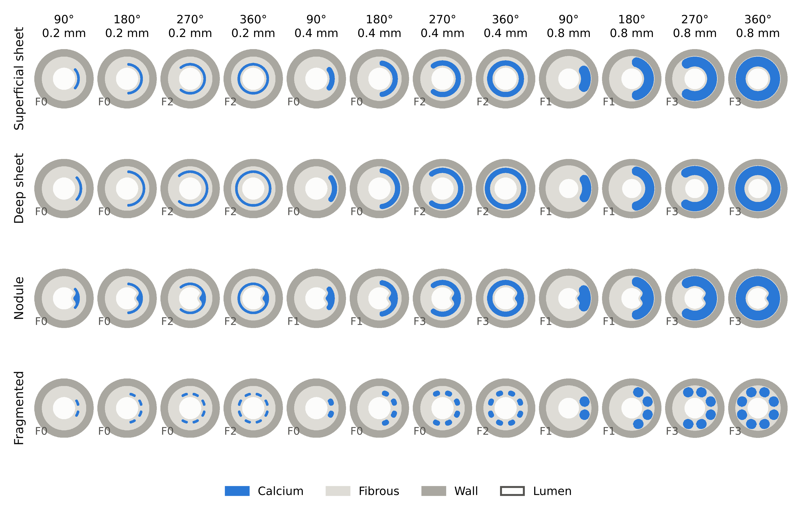

 In Silico Digital Twins of Calcified Coronary Lesions under Intravascular Lithotripsy and Stenting

# 2. Materials and Methods

## 2.1. Lesion Cohort

The core set contains 48 two-dimensional lesions and the hold-out set 24 lesions (Figure 1). Calcium fracture under IVL is reported in [1,2].

**Figure 1.** Core factorial cohort.

# References

1. Hill, J. M.; et al. Intravascular Lithotripsy for Treatment of Severely Calcified Coronary Artery Disease. *Journal of the American College of Cardiology* **2020**. https://doi.org/10.1016/j.jacc.2020.09.603.

2. Ali, Z. A.; et al. Safety and Effectiveness of Coronary Intravascular Lithotripsy for Treatment of Severely Calcified Coronary Stenoses: The Disrupt CAD II Study. *Circulation: Cardiovascular Interventions* **2019**, *12*, e008434. https://doi.org/10.1161/CIRCINTERVENTIONS.119.008434.
